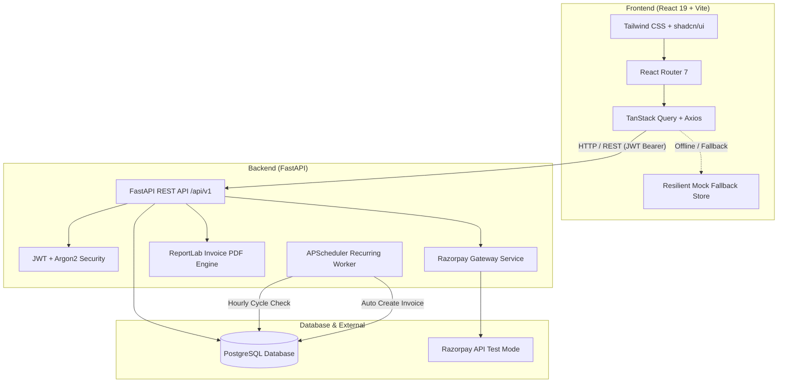

# 🚀 Brightloop SubFlow — Subscription & Recurring Billing Management System

[](https://fastapi.tiangolo.com)
[](https://react.dev/)
[](https://vitejs.dev/)
[](https://www.postgresql.org/)
[](https://tailwindcss.com/)
[](https://opensource.org/licenses/MIT)

A centralized, enterprise-grade platform designed to automate and streamline **subscription lifecycle management**, **automated recurring billing**, **quotation-to-subscription workflows**, **dynamic tax & discount calculations**, **payment reconciliation**, and **real-time financial analytics** for SaaS and recurring-revenue businesses.

---

## 📑 Table of Contents

- [Overview](#-overview)
- [Key Features](#-key-features)
- [System Architecture](#-system-architecture)
- [Technology Stack](#-technology-stack)
- [Project Directory Structure](#-project-directory-structure)
- [Prerequisites](#-prerequisites)
- [Step-by-Step Installation & Setup](#-step-by-step-installation--setup)
  - [1. Clone Repository](#1-clone-the-repository)
  - [2. Database Setup (PostgreSQL)](#2-database-setup-postgresql)
  - [3. Backend Setup (FastAPI)](#3-backend-setup-fastapi)
  - [4. Frontend Setup (React + Vite)](#4-frontend-setup-react--vite)
- [Default Login Credentials](#-default-login-credentials)
- [Environment Configuration](#-environment-configuration)
- [Running Automated Tests](#-running-automated-tests)
- [API Documentation & Key Endpoints](#-api-documentation--key-endpoints)
- [Core Application Workflows](#-core-application-workflows)
- [Troubleshooting & FAQ](#-troubleshooting--faq)
- [Git Branching Strategy](#-git-branching-strategy)

---

## 💡 Overview

Traditional subscription operations rely on scattered spreadsheets, manual invoice drafting, missed renewal dates, and difficult revenue reconciliation. **Brightloop SubFlow** replaces these error-prone manual tasks with a single unified engine:

- **Automates** recurring billing with scheduled background workers.
- **Converts** negotiated quotations directly into active subscriptions with a single click.
- **Prevents** duplicate invoices for overlapping billing intervals.
- **Enforces** granular, role-based access control (Admin, Staff, Customer).
- **Tracks** real-time financial health through Monthly Recurring Revenue (MRR), overdue aging, and automated PDF invoice generation.

---

## ✨ Key Features

### 1. 🔐 Authentication & Role-Based Access Control (RBAC)
- Secure user signup, login, and token refresh using **JWT (JSON Web Tokens)** and **Argon2** password hashing.
- Role-segregated navigation and permissions:
  - **Admin**: Full platform access (Users, Products, Plans, Taxes, Discounts, Invoices, Subscriptions, Payments, Reports).
  - **Staff**: Operational access (Customers, Quotations, Subscriptions, Invoices, Payments).
  - **Customer**: Self-service portal (Active subscriptions, Invoice download, Online payment, Profile).
- Admin-controlled staff provisioning and password-reset workflows.

### 2. 📦 Product & Plan Management
- Manage software products with base sales price and cost price tracking.
- Support **product variants** with incremental pricing (e.g., standard vs. enterprise editions).
- Subscription plans with custom billing frequencies: **Daily**, **Weekly**, **Monthly**, and **Yearly**.
- Plan constraints: Minimum quantities, start/end validity dates, and lifecycle rules (auto-close, allow pause, early cancellation).

### 3. 📜 Quotation Lifecycle Management
- Create customer quotations with customized product lines, quantities, and negotiated discounts.
- Quotation templates for standardized recurring customer proposals.
- **Quotation Status Pipeline**: `Draft` ➔ `Sent` ➔ `Approved` ➔ `Converted` (or `Rejected` / `Expired`).
- One-click conversion from approved quotation into an active subscription and initial invoice.

### 4. 🔄 Subscription Lifecycle Engine
- Lifecycle states: `Draft` ➔ `Quotation` ➔ `Confirmed` ➔ `Active` ➔ `Paused` ➔ `Closed`.
- Automated tracking of billing cycles (`start_date`, `next_billing_date`, `end_date`).
- Administrative actions to pause, resume, extend, or terminate subscriptions.

### 5. ⚡ Automated Recurring Invoicing & APScheduler
- Background scheduler (**APScheduler**) evaluates subscriptions due for renewal.
- Automatically generates invoices for active subscriptions on their `next_billing_date`.
- **Idempotent Billing**: Strictly guards against duplicate invoices for the same billing window.
- Computes subtotal, dynamic discount deductions, and tax line items.
- On-the-fly downloadable **PDF Invoices** with dynamic QR codes generated via **ReportLab**.

### 6. 🏷️ Taxes & Smart Discount Engine
- Configurable tax rules (e.g., GST 18%, VAT 5%).
- Flexible discounts: **Percentage** or **Fixed Amount** discounts.
- Enforces validity constraints: Minimum purchase amount, minimum item quantity, expiration date, and maximum usage counters.

### 7. 💳 Payments & Reconciliation
- Record manual payments (Cash, Bank Transfer, Cheque) or online payments.
- Supports **partial payments** with live recalculation of invoice balance and auto-transition to `PAID` or `PARTIALLY_PAID`.
- Integrated **Razorpay Payment Gateway (Test Mode)** with order creation, modal checkout, and webhook signature verification.

### 8. 📊 Dashboards & Analytics
- Visual dashboards with **Recharts**:
  - Total Active Subscriptions & Growth Metrics.
  - Total Revenue Collected vs. Outstanding Balance.
  - Overdue Invoice alerts and urgent action items.
  - Monthly Recurring Revenue (MRR) estimates.

---

## 🏗️ System Architecture



---

## 💻 Technology Stack

| Layer | Technologies |
|---|---|
| **Frontend** | React 19, Vite 8, Tailwind CSS, React Router 7, TanStack Query 5, Axios, Lucide React, Recharts |
| **Backend** | Python 3.10+ / 3.14, FastAPI, SQLAlchemy 2.0, Pydantic v2, PyJWT, Pwdlib (Argon2), Uvicorn |
| **Database** | PostgreSQL 14+ (Connection via `psycopg` v3 binary) |
| **Task Scheduling** | APScheduler (Advanced Python Scheduler) |
| **Document Export** | ReportLab, Pillow, QRCode |
| **Payment Gateway** | Razorpay Python SDK |
| **Testing** | Pytest, Pytest-Asyncio, Vitest, React Testing Library |

---

## 📁 Project Directory Structure

```text
Makeathon/
├── backend/
│   ├── app/
│   │   ├── api/
│   │   │   ├── deps.py               # Dependency injection & JWT token guards
│   │   │   └── v1/
│   │   │       ├── auth.py           # Authentication & token issuance
│   │   │       ├── users.py          # User management & staff creation
│   │   │       ├── products.py       # Products and product variants
│   │   │       ├── plans.py          # Subscription plans & billing frequencies
│   │   │       ├── quotations.py     # Quotation CRUD & subscription conversion
│   │   │       ├── subscriptions.py  # Subscription lifecycle management
│   │   │       ├── invoices.py       # Invoice management & PDF generation
│   │   │       ├── payments.py       # Payment recording & Razorpay checkout
│   │   │       ├── discounts.py      # Promo codes & discount validation
│   │   │       ├── taxes.py          # Tax rate configuration
│   │   │       └── dashboards.py     # Role-based KPI metrics & financial summaries
│   │   ├── core/
│   │   │   ├── config.py             # Pydantic Settings & environment variables
│   │   │   └── security.py           # Password hashing & JWT token encoding
│   │   ├── models/                   # SQLAlchemy declarative ORM models
│   │   ├── schemas/                  # Pydantic request & response schemas
│   │   ├── services/                 # Business logic (Invoice, Payment, PDF, Razorpay)
│   │   ├── tasks/
│   │   │   └── billing_scheduler.py  # Automated recurring billing background worker
│   │   ├── database.py               # Database engine & session generator
│   │   ├── main.py                   # FastAPI initialization & CORS setup
│   │   └── seed.py                   # Database seeder (Admin, Staff, Customer, Plans)
│   ├── tests/                        # Backend test suites (Pytest)
│   ├── .env.example                  # Backend environment template
│   ├── pytest.ini                    # Pytest configuration
│   └── requirements.txt              # Python package dependencies
├── frontend/
│   ├── public/                       # Static icons and assets
│   ├── src/
│   │   ├── components/               # Reusable UI widgets, modals, tables, badges
│   │   ├── context/                  # AuthContext & session state
│   │   ├── layouts/                  # AuthLayout, AdminLayout, StaffLayout, CustomerLayout
│   │   ├── pages/                    # Domain pages (Admin, Staff, Customer, Auth)
│   │   ├── routes/
│   │   │   └── AppRoutes.jsx         # Role-based route definitions
│   │   ├── services/                 # Axios API clients & mock data store
│   │   └── __tests__/                # Frontend unit & integration tests (Vitest)
│   ├── .env.example                  # Frontend environment template
│   ├── package.json                  # Node dependencies & npm scripts
│   ├── tailwind.config.js            # Tailwind styling config
│   └── vite.config.js                # Vite build configuration
└── README.md                         # Comprehensive project documentation
```

---

## ⚙️ Prerequisites

Before you begin, ensure you have the following installed on your machine:

1. **Python**: Version `3.10` or higher (tested with Python 3.12 and 3.14).
2. **Node.js**: Version `18.x` or higher (with `npm` v9+).
3. **PostgreSQL**: Version `14.x` or higher running locally or in Docker.
4. **Git**: Version control system.

---

## 🛠️ Step-by-Step Installation & Setup

### 1. Clone the Repository

```bash
git clone https://github.com/isaac-00077/Makeathon.git
cd Makeathon
```

---

### 2. Database Setup (PostgreSQL)

Make sure your PostgreSQL server is active. Open a terminal or PostgreSQL client (`psql`, pgAdmin, or DBeaver) and create the database:

```sql
CREATE DATABASE hackathon_db;
```

*(Optional)* If you wish to use a dedicated database user:
```sql
CREATE USER postgres WITH ENCRYPTED PASSWORD 'postgres';
GRANT ALL PRIVILEGES ON DATABASE hackathon_db TO postgres;
```

> **Note:** The backend automatically provisions all tables upon startup via SQLAlchemy metadata creation. No manual SQL table scripts are required!

---

### 3. Backend Setup (FastAPI)

1. Open a terminal and navigate to the `backend` folder:
   ```bash
   cd backend
   ```

2. Create a Python virtual environment:
   - **Windows (PowerShell):**
     ```powershell
     python -m venv .venv
     .\.venv\Scripts\Activate.ps1
     ```
     *(If script execution is disabled on Windows, run `Set-ExecutionPolicy -Scope Process -ExecutionPolicy Bypass` first)*
   - **macOS / Linux:**
     ```bash
     python3 -m venv .venv
     source .venv/bin/activate
     ```

3. Install required Python packages:
   ```bash
   pip install --upgrade pip
   pip install -r requirements.txt
   ```

4. Configure backend environment variables:
   Copy `.env.example` to `.env`:
   - **Windows:** `copy .env.example .env`
   - **macOS/Linux:** `cp .env.example .env`

   Edit `.env` to match your PostgreSQL credentials and preferences:
   ```env
   DB_HOST=localhost
   DB_PORT=5432
   DB_NAME=hackathon_db
   DB_USER=postgres
   DB_PASSWORD=postgres

   SECRET_KEY=brightloop_super_secret_jwt_key_hackathon_2026_change_in_production
   ENABLE_BILLING_SCHEDULER=True
   BILLING_CHECK_INTERVAL_MINUTES=60

   # Razorpay Test Credentials (Optional)
   RAZORPAY_KEY_ID=rzp_test_1DP5mmOlF5G5ag
   RAZORPAY_KEY_SECRET=mock_razorpay_secret_key_12345
   RAZORPAY_WEBHOOK_SECRET=mock_webhook_secret_key_12345
   ```

5. Seed the database with sample data (Default Users, Products, Variants, & Plans):
   ```bash
   python -m app.seed
   ```

6. Start the FastAPI development server:
   ```bash
   uvicorn app.main:app --reload --port 8000
   ```
   The backend API will be live at: **`http://localhost:8000`**  
   Interactive Swagger UI will be available at: **`http://localhost:8000/docs`**

---

### 4. Frontend Setup (React + Vite)

1. Open a new terminal window and navigate to the `frontend` folder:
   ```bash
   cd frontend
   ```

2. Install Node dependencies:
   ```bash
   npm install
   ```

3. Configure frontend environment variables:
   Copy `.env.example` to `.env`:
   - **Windows:** `copy .env.example .env`
   - **macOS/Linux:** `cp .env.example .env`

   Default `.env` settings:
   ```env
   VITE_API_BASE_URL=http://localhost:8000
   VITE_APP_NAME=SubFlow
   VITE_RAZORPAY_KEY_ID=rzp_test_1DP5mmOlF5G5ag
   ```

4. Launch the Vite development server:
   ```bash
   npm run dev
   ```
   The frontend application will be running at: **`http://localhost:5173`**

---

## 🔑 Default Login Credentials

The seed script (`python -m app.seed`) pre-configures three accounts for testing all user roles:

| Role | Email Address | Password | Permissions & Dashboard |
|---|---|---|---|
| **Admin** | `admin@brightloop.com` | `AdminPassword123!` | Full system administration, staff creation, product/plan catalog, reports, financial analytics. |
| **Staff** | `staff@brightloop.com` | `StaffPassword123!` | Customer operations, quotation generation, subscription management, payment records. |
| **Customer** | `customer@example.com` | `CustomerPass123!` | Self-service customer portal, view subscription status, review invoices, make payments. |

---

## 🔧 Environment Configuration

### Backend Parameters (`backend/.env`)

| Variable | Default Value | Description |
|---|---|---|
| `DB_HOST` | `localhost` | PostgreSQL host address |
| `DB_PORT` | `5432` | PostgreSQL port |
| `DB_NAME` | `hackathon_db` | PostgreSQL database name |
| `DB_USER` | `postgres` | PostgreSQL username |
| `DB_PASSWORD` | `postgres` | PostgreSQL password |
| `SECRET_KEY` | *(Secret string)* | JWT HMAC signing key |
| `ACCESS_TOKEN_EXPIRE_MINUTES` | `1440` (24h) | JWT access token duration |
| `ENABLE_BILLING_SCHEDULER` | `True` | Toggle automatic APScheduler recurring billing worker |
| `BILLING_CHECK_INTERVAL_MINUTES`| `60` | Frequency in minutes for recurring billing execution |
| `RAZORPAY_KEY_ID` | `rzp_test_...` | Razorpay public key for test checkout |
| `RAZORPAY_KEY_SECRET` | *(Secret string)* | Razorpay private key (kept backend-only) |

### Frontend Parameters (`frontend/.env`)

| Variable | Default Value | Description |
|---|---|---|
| `VITE_API_BASE_URL` | `http://localhost:8000` | Target FastAPI backend base URL |
| `VITE_APP_NAME` | `SubFlow` | Application display title |
| `VITE_RAZORPAY_KEY_ID` | `rzp_test_...` | Public Razorpay key injected into checkout modal |

---

## 🧪 Running Automated Tests

### Backend Unit & Integration Tests (Pytest)
The backend test suite verifies password policies, JWT authentication, user role privileges, product variant logic, and plan operations:

```bash
cd backend
# With virtual environment activated:
pytest tests
```

### Frontend Tests (Vitest)
The frontend test suite verifies quotation conversions, subscription state changes, discount calculation routines, and payment balance reconciliation:

```bash
cd frontend
npm run test
```

---

## 📡 API Documentation & Key Endpoints

When the backend is running, access interactive OpenAPI documentation:
- **Swagger UI**: [http://localhost:8000/docs](http://localhost:8000/docs)
- **ReDoc**: [http://localhost:8000/redoc](http://localhost:8000/redoc)

### Summary of REST API Modules

| Method | Endpoint | Description | Role Access |
|---|---|---|---|
| `POST` | `/api/v1/auth/login` | Authenticate user & return JWT token | Public |
| `POST` | `/api/v1/auth/register` | Customer self-registration | Public |
| `GET` | `/api/v1/auth/me` | Fetch authenticated user profile | Authenticated |
| `GET` | `/api/v1/products` | List all products with variant pricing | Authenticated |
| `POST` | `/api/v1/products` | Create product and variants | Admin / Staff |
| `GET` | `/api/v1/plans` | List subscription plans | Authenticated |
| `POST` | `/api/v1/plans` | Create a new subscription plan | Admin |
| `GET` | `/api/v1/quotations` | List quotations with search & status filters | Admin / Staff |
| `POST` | `/api/v1/quotations` | Create a new customer quotation | Admin / Staff |
| `POST` | `/api/v1/quotations/{id}/convert` | Convert approved quotation to subscription | Admin / Staff |
| `GET` | `/api/v1/subscriptions` | List subscriptions (isolated for customers) | Authenticated |
| `POST` | `/api/v1/subscriptions/{id}/pause` | Pause an active subscription | Admin / Staff |
| `POST` | `/api/v1/subscriptions/{id}/resume`| Resume a paused subscription | Admin / Staff |
| `GET` | `/api/v1/invoices` | List invoices and outstanding balances | Authenticated |
| `GET` | `/api/v1/invoices/{id}/pdf` | Generate and download ReportLab PDF invoice | Authenticated |
| `POST` | `/api/v1/payments` | Record manual or gateway payment against invoice | Admin / Staff |
| `POST` | `/api/v1/payments/razorpay/create-order` | Create order for Razorpay checkout | Authenticated |
| `POST` | `/api/v1/payments/razorpay/verify` | Verify Razorpay payment signature | Authenticated |
| `GET` | `/api/v1/dashboards/admin` | Fetch comprehensive revenue & KPI metrics | Admin |
| `GET` | `/api/v1/dashboards/staff` | Fetch customer and active quotation queues | Staff / Admin |
| `GET` | `/api/v1/dashboards/customer`| Fetch customer subscription & invoice summaries| Customer |

---

## 🔁 Core Application Workflows

### 1. Quotation to Subscription Conversion
```
1. Customer registers or Staff creates customer account.
2. Staff prepares Quotation selecting Product, Plan, and Quantities.
3. System applies tax rates and applicable discount rules.
4. Staff sends Quotation ➔ Customer reviews & accepts.
5. System converts Quotation ➔ Generates Active Subscription.
6. Initial billing invoice is automatically created.
```

### 2. Automated Recurring Billing Cycle
```
1. APScheduler runs background check every 60 minutes.
2. Queries all subscriptions where status = ACTIVE and next_billing_date <= today.
3. Checks existing invoices to prevent duplicate billing for the current period.
4. Creates new Invoice with computed line items, taxes, and discounts.
5. Advances subscription's next_billing_date to the subsequent cycle.
6. Updates invoice status to PENDING and alerts customer.
```

### 3. Payment Reconciliation & Invoice Statuses
```
Invoice Amount: ₹1,560.00 | Status: PENDING
       │
       ├─► Record Payment: ₹560.00
       │   └─ Balance: ₹1,000.00 | Status: PARTIALLY_PAID
       │
       └─► Record Payment: ₹1,000.00
           └─ Balance: ₹0.00     | Status: PAID
```

---

## ❓ Troubleshooting & FAQ

### Q1: `psycopg.OperationalError: connection to server at "localhost" failed`
- **Solution**: Verify PostgreSQL is running (`Get-Service postgresql*` on Windows or `sudo systemctl status postgresql` on Linux). Ensure the `DB_USER` and `DB_PASSWORD` in `backend/.env` match your local PostgreSQL configuration.

### Q2: Windows PowerShell error: `Execution of scripts is disabled on this system`
- **Solution**: Run `Set-ExecutionPolicy -Scope Process -ExecutionPolicy Bypass` in your PowerShell window and then re-run `.\.venv\Scripts\Activate.ps1`.

### Q3: Frontend shows "Network Error" or cannot reach API
- **Solution**: Ensure the backend server is running on `http://localhost:8000`. Check that `frontend/.env` contains `VITE_API_BASE_URL=http://localhost:8000`. The frontend includes a fallback mock store so you can explore the UI even if the backend is briefly offline.

### Q4: Port 8000 or 5173 is already in use
- **Backend on alternative port**:
  ```bash
  uvicorn app.main:app --reload --port 8080
  ```
  *(Update `VITE_API_BASE_URL=http://localhost:8080` in `frontend/.env`)*
- **Frontend on alternative port**:
  ```bash
  npm run dev -- --port 3000
  ```

---

## 🌿 Git Branching Strategy

The repository follows a clean, feature-driven branching model:

| Branch | Description |
|---|---|
| `main` | Production-ready stable release |
| `dev` | Central integration branch |
| `feature/auth-products-plans` | User authentication, RBAC, products, variants, and plans |
| `feature/quotations-subscriptions` | Quotation creation, approval, and subscription lifecycle |
| `feature/billing-payments` | Invoices, APScheduler recurring billing, taxes, discounts, and payments |
| `feature/frontend` / `elaine-frontend` | React UI components, dashboards, customer portal, and routing |

---

## 👥 Contributors & Acknowledgements

Developed with ❤️ during the **Makeathon / Hackathon 2026** by the Brightloop Team.
Special thanks to the open-source communities behind FastAPI, React, Tailwind CSS, and SQLAlchemy.
